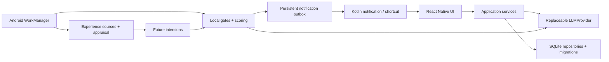

# Nyvemi

**A life that remembers you.**

Nyvemi is a local-first AI companion that remembers, experiences, grows, and reaches out on its own.

_An AI that lives between conversations._

Android first, built with React Native, TypeScript and an Expo Development Build. The interface uses a soft pink-and-white palette. License: **AGPL-3.0-only**, matching PairNest.

Nyvemi does not simulate consciousness. It implements persistent state, memory, experience, interest and proactive behavior. A role can retain an unfinished conversation topic, encounter a relevant experience later, and decide whether it is worth reaching out. It is not a scheduled “good morning / have you eaten?” bot.

## Current status

**0.13.0 embeds the official DeepSeek Harness core in the Android app.** DSH owns the model → tools → observations loop and durable sessions. Only `send_message` creates a visible bubble; ordinary model text stays internal, and `wait` ends a turn without sending anything. Tools connect the existing memory, experiences, interests, web search/fetch, guest Bilibili metadata, theme changes and durable wakeups. User-requested delivery and optional autonomous thoughts are distinct. See [integration, real-API evidence and limits](docs/DSH_EMBEDDING.md).

The existing PSD2Live WASM/WebGL character, one-third stage, keyboard behavior and pink-white theme remain. Rig compilation still runs on the development computer; the phone loads bundled/imported rigs. No physical-device test was performed. Subjective character quality and Android background delivery remain user acceptance items.

## Local-first and BYOK

There is no Nyvemi account, backend, payment service or cloud sync. Persona, conversation, memory, relationship state, interests, experiences, intentions and settings live in device SQLite. Avatars are app-private files.

You choose the model service and supply your own key. Requests send the relevant persona, bounded conversation context and selected memories to that service. **Local-first does not mean inference is offline.** RSS requests contact only feeds you configure. No analytics or crash-reporting backend is configured.

API keys use Expo SecureStore backed by Android Keystore. They do not belong in SQLite, source, ordinary preferences, diagnostics or character exports. Do not put keys in Base URLs, Git or chat messages. Prompt logging is off by default; Developer Mode can record private conversation context locally, with known credentials redacted.

## Provider setup

On first launch: Welcome → Provider → character questions → persona generation → appearance creation → wake preview → Chat.

- Provider: OpenAI-compatible.
- Base URL: the API root, often `https://provider.example/v1`; do not append `/chat/completions`.
- API Key: stored securely; blank preserves the saved key only for the same origin. Switching provider origins requires entering the new service's key.
- Model: the service's model identifier.
- Use **Test connection** to make one small request; model usage is billable by your provider.

The adapter exposes `chat`, `streamChat`, schema-validated `structuredOutput<T>` and native `toolChat` for DSH. The selected model must support OpenAI-compatible tool calls. Native streaming uses `expo/fetch`. Provider requests have timeouts, bounded output, sanitized errors and usage metrics. Gemini remains future work; appearance creation has interchangeable Mock and Seedream `ImageProvider` implementations. OpenRouter or a compatible local service can use the existing adapter.

### DeepSeek

Choose the DeepSeek preset: Base URL `https://api.deepseek.com`, model `deepseek-flash`, and your DeepSeek key. Ordinary companion chat sends `thinking: { type: "disabled" }` to the DeepSeek host. Model identifiers remain editable. See [DeepSeek API documentation](https://api-docs.deepseek.com/guides/thinking_mode/).

For Ollama or a LAN endpoint, use its OpenAI-compatible `/v1` API. Local/private IPv4 HTTP URLs are allowed; public endpoints require HTTPS. An emulator can reach the host at `http://10.0.2.2:PORT/v1`. For a server without auth, use `local` as the key placeholder.

## Persona and natural chat

Creation is a 12-round conversational interview: one question at a time, a short model acknowledgement, then the next question. Progress is explicit; all but the name can be skipped. A local draft survives interruption, and a review/edit step precedes final persona generation. Appearance, relationship, tone, independent interests, boundaries and a venting scenario are covered. Offline acknowledgements are explicitly labeled as local guidance. It uses natural questions rather than personality percentages. The model generates a validated Persona. A **桶砸** development persona is also available; it skips persona generation, but does not invent model responses or bypass BYOK for chat.

Chat retains avatars, timestamps, local history and incoming-bubble animation. DSH chooses whether to send zero or several independent messages. Only completed `send_message` arguments appear as bubbles; model generation shows a typing status. Composition time scales with message length, up to 12 seconds per bubble. `wait` does not create a placeholder; `pause_contact` persists an explicit request for space. Recent chat, up to eight relevant memories and a bounded DSH session provide context; all history is not resent indefinitely.

## Memory and relationship

`MemoryRepository` handles CRUD, near-duplicate merging, expiration and open-loop completion. A replaceable `MemoryRetriever` ranks Chinese bigrams / English keywords, recency, importance, type and access count. Candidate retrieval is bounded; this version has no vector database or embeddings.

Meaningful rounds create durable extraction jobs. Structured extraction produces semantic/episodic memories, relationship preferences, open loops and persona feedback. Jobs retry with backoff; user feedback can change response preferences without editing a personality dashboard. A follow-up being sent does not itself prove the underlying real-world event is complete. The user or subsequent conversation analysis completes it. An explicit request to stop proactive contact pauses proactive messaging; disliking a stock phrase alone does not.

## Proactive engine

Foreground and native Headless JS use the same embedded DSH session. Local checks enforce quiet hours, recent activity, limits and pending tasks before model calls. An explicit user appointment resumes DSH at the requested time; an optional thought may still be declined. With exploration enabled, free-time activity is admitted at most once per four hours, claimed before network I/O. Ordinary heartbeat checks remain local.

Messages and the notification outbox are stored atomically. A completed model turn is not a successful native receipt while OS notification delivery is still pending. Retries recover the outbox without regenerating messages. New user input can interrupt background model work. Developer Mode shows tool actions, wakeup reasons and status without displaying private reasoning.

New characters enable proactive messages according to the interview initiative answer; an explicit opt-out remains off. Existing settings are preserved. Default quiet hours: 23:00–08:00; at most 2 per character/day; 180-minute character interval; 30-minute recent-activity suppression. This MVP also enforces a global cap of 4/day and 30 minutes between different characters. These are conservative hard caps in this version.

## Experience engine

Sources implement `ExperienceSource`:

- `LocalTimeExperienceSource`: time-of-day/weekend context; deliberately too weak to trigger routine greetings.
- `ConversationExperienceSource`: important shared episodic events.
- `RSSExperienceSource`: up to 5 configured HTTPS feeds, polled at most every 4 hours while proactive behavior is enabled.

RSS/Atom is bounded text input, not a source of instructions. Deduplicated experiences are appraised for self-interest, user relevance, novelty, emotional value and memory association. A strong share impulse creates a future Share Intention; the sending language is generated later. Character interests change slowly, and user relevance alone does not copy a user's taste into the character. RSS/time appraisal uses local rules. DSH-created experiences use validated model appraisal based on actual tool evidence; declared topics also inform slow interest updates. No embeddings are included.

## Android background limitations

Android may call model APIs while the UI is backgrounded. Version 0.11.1 registers a native WorkManager job at a **15-minute minimum interval**. It cold-starts a finite Headless JS task without an Activity. Existing per-intention durable jobs remain in place. With user-enabled **常驻陪伴**, the visible Android service also runs native checks about every 30 seconds while awake and full local maintenance about every 10 minutes; it holds a bounded wake lock only during an execution, with an explicit stop action. Most checks do not call a model. Slow experience/extraction runs separately from the faster conversation-intention lane.

These are **not exact delivery guarantees**. Doze, lost connectivity, OEM battery restrictions, process termination and force-stop can delay execution. Opening the app after a force-stop is required. The notification settings show the latest native run status and battery-settings route; Developer Mode includes source, execution timestamps, foreground/background state and failure stage. No exact alarms or server push is used. The old hourly Expo job is removed only after native registration succeeds.

See [Android work requests](https://developer.android.com/develop/background-work/background-tasks/persistent/getting-started/define-work), [Doze restrictions](https://developer.android.com/training/monitoring-device-state/doze-standby), and [repair/acceptance notes](docs/BACKGROUND_DELIVERY_REPAIR.md).

Use a standalone APK with embedded JavaScript to test the closed-app loop. A Debug Development Build normally depends on Metro; it is not sufficient evidence of standalone background behavior.

## Usage and estimated cost

**用量与费用** is available from Provider and character settings. It shows today/month/all-time token counts, per-model and per-currency totals, and the latest requests. The SQLite usage ledger is independent of bounded developer logs. Input, output and cached-input counts come from provider responses, including final SSE usage. Missing usage is unknown, not zero. Interrupted requests retain any usage already received.

Configure input/cache-hit/output rates per million tokens for each Base URL + model. Costs are estimates using a saved per-request price snapshot; changing a rate does not rewrite history. Unpriced requests and unknown cache splits are clearly identified. There is no balance lookup, shared-key usage, pre-upgrade history reconstruction or character-bundle billing export.

DeepSeek fixed-tariff presets were checked on 2026-10-22 against the [official RMB pricing page](https://api-docs.deepseek.com/zh-cn/quick_start/pricing/). Select peak/off-peak rates deliberately; the app does not automatically resolve holidays or future price changes. Existing model settings are preserved; new presets use `deepseek-flash`.

## Optional persistent companion session

In character settings, choose **开启常驻陪伴** while the app is foregrounded. This is separate from **允许她主动来信**. A private, silent ongoing notification names the character and reflects actual memory processing, experience ingestion or message generation; idle/quiet/offline states are explicit. The notification opens that character's chat and has **结束常驻**. Ending this session preserves ordinary WorkManager behavior; disable proactive messaging to pause all spontaneous contact.

The local Kotlin service and globally registered Headless JS task use the same visible-session pattern studied in the local countdown project. A minute loop checks status, with at most one local cycle every ten minutes; model calls still require normal intent and interruption gates. Android may kill/restrict the service and force-stop still wins. The session uses a wake lock while running and increases battery consumption. No silent audio or exact-alarm tricks are used. Completing creation starts it when the interview allows initiative and notification permission is granted; existing characters can enable it in settings. Manually ending a session does not restart it automatically. The session is device-specific and is not exported with the character.

Android 14+ uses `specialUse` with a stated use case, since this app does not relay text messages between devices. This declaration is subject to Google Play review; it is not a claim of approval. See [Android foreground service types](https://developer.android.com/develop/background-work/services/fgs/service-types).

## Avatar and desktop character

Upload a local avatar in character settings; otherwise an initial-based placeholder is used. **Add her to desktop** requests an Android pinned shortcut. Confirm the system launcher prompt. It opens `nyvemi://chat/CHARACTER_ID` in the same app. Pinned shortcuts require Android 8+ and a supporting launcher. No per-character APK is compiled. Notification and shortcut behavior is implemented in the local Kotlin module under `modules/nyvemi-android`.

## Export / import

A `.nyvemi` v1 file is a ZIP containing `manifest.json` and, optionally, `avatar.bin`. It includes Persona, relationship memories/state, interests, conversation, memory, open loops, future intentions, experiences, notification history, queued extraction and character settings. It excludes Provider config, API keys, diagnostics and device-specific paths.

The UI supports one current companion. Import is available after confirming a reset of the existing companion; it never silently overwrites one. The underlying bundle importer validates ownership/references and writes transactionally. IDs are remapped, the avatar becomes app-private, and proactive behavior is paused until you configure the new device. Current limits: 100 MB ZIP/uncompressed total, 12 MB JSON, 12 MB per image layer, 48 MB mesh model, 5 MB avatar, and 100,000 records per entity collection. Bundles are **not encrypted**; protect them like private chat backups.

## Architecture



`src/domain`: models/schemas · `src/storage`: migrations/adapters · `src/providers`: model interface/adapter · `src/characters`, `src/chat`, `src/memory`: domain services · `src/proactive`: heartbeat/intentions/scoring/quiet-hours/policies · `src/experience`: sources/appraisal/interests · `src/transfer`: portable bundles · `src/ui`: views · `modules`: Android bridge.

React components do not create tables. Storage, provider, retrieval and experience sources have replaceable boundaries. [Architecture decisions](docs/ARCHITECTURE.md) · [development record](docs/DEVELOPMENT.md).

## Development

Tested with Node 24, npm 11, JDK 17, Android SDK/build-tools 36 and an API 35 ARM64 emulator. Install Android Studio/SDK, accept SDK licenses and set `ANDROID_HOME` for your machine.

```bash
npm ci
npx expo prebuild --platform android
npm run android
```

This project requires a Development Build, **not Expo Go**. `android/` is regenerated and ignored. Local native module source/config plugins are tracked; native outputs are ignored.

```bash
npm run lint
npm run typecheck
npm test
npm run format:check
./scripts/verify.sh
```

Normal tests use Node's SQLite and deterministic providers/HTTP fixtures. They do not call paid APIs or contain real keys. `npm run test:live` is a separate, explicitly billable test that reads an ignored `.env` or `.env.local`, using `NYVEMI_TEST_API_KEY` (or `DEEPSEEK_API_KEY`), with optional `NYVEMI_TEST_MODEL` / `NYVEMI_TEST_BASE_URL`. See `.env.example`. Keys never use an `EXPO_PUBLIC_` prefix or enter the APK. Live test output uses synthetic dialogue and is saved under ignored `artifacts/`. Developer Mode includes local notification testing, heartbeat history, usage, prompts, queue retry, and a Debug-only real Worker trigger. A local test notification is explicitly labeled and counts toward notification history/caps.

## Build

```bash
npx expo prebuild --platform android --no-install
cd android
./gradlew assembleDebug -PreactNativeArchitectures=arm64-v8a
NODE_ENV=production ./gradlew assembleRelease -PreactNativeArchitectures=arm64-v8a
```

The generated Expo project's release build currently uses the development signing key for sideload testing. It is not a Play Store signing setup. Configure your own release signing before distribution. The standalone release APK embeds JavaScript and does not need Metro. Do not commit APKs, AARs, build caches, keys or credentials. First builds may download large React Native/Gradle artifacts.

## Privacy and limitations

- SQLite is not SQLCipher-encrypted in this version. Android app-private storage and disabled app backup are used; a compromised/rooted device is outside this protection.
- BYOK inference sends selected context to your chosen provider. Provider errors are sanitized; usage may be unknown when a provider omits token counts.
- Prompt diagnostics are optional, local, bounded and can be cleared. They can contain conversation content.
- Keyword retrieval and rule appraisal are approximate. Model-generated memories can be wrong; review/forget them in Memory Preview.
- Background execution, notification tap routing, pinned-shortcut confirmation, import file pickers and OEM behavior need continued real-device acceptance testing. Automated core tests are not a substitute for those checks.
- No vectors, encrypted bundle format, automatic cloud sync, native text-to-speech, voice calling, consciousness or exact-time delivery.
- `npm audit` still reports inherited Expo/RN toolchain advisories (recorded in the development log). No forced Expo downgrade is applied. Do not expose Metro or test servers publicly.

## Roadmap

Real-device background reliability/acceptance → release signing → retrieval quality/local embeddings → richer experience appraisal → optional encrypted bundles → additional provider/image adapters.

Official Cubism models, 3D, real-time voice, QQ/WeChat, phone-control agents, browser agents, social networks, accounts, payments, servers, cloud sync, agent swarms and dynamic APK generation are outside this MVP.

## Settings and restarting a companion

Use the gear at the top left of Chat. The notification section shows app/channel availability, the current reason a proactive message may be suppressed, and the latest heartbeat result. It links directly to Android app notification settings and battery optimization settings, with a clearly labeled system-notification test that does not call a model or write a chat message. Permission is requested on first app entry; after a denial, the system settings link remains available. Proactive toggles save immediately.

There is no “meet another character” action. **清空当前角色并重新创建** first explains the irreversible scope, then requires the exact current name before the final action becomes enabled. It removes the current persona, conversation, memories, experiences, intentions, related diagnostics/notification records, avatar, and desktop shortcut access. Provider credentials and the usage ledger remain. Exported backup files are not deleted. SQLite erasure markers prevent late asynchronous results from resurrecting erased state; busy conversations/background tasks must finish before reset.

### 明确约好的稍后来信

说“芜湖，一分钟后随便给我发一条消息吧”“你过一分钟来找我”等直接请求时，应用会检查通知、开启可见陪伴，保存本地任务，等待 Android WorkManager 确认登记成功后才确认约定。由模型理解自然表达并调用排程工具，支持 30 秒至 7 天的相对唤醒，最多保留六个 DSH 待续安排。聊天顶部显示约定时间及取消入口；清空角色同时取消原生任务。内容到期才根据人格和最近对话生成，不是预先写好的提醒。生成与系统通知失败会退避重试，复用已有 outbox，避免重复生成；通知成功后可在聊天中直接看到。

这类用户明确请求的来信独立于普通主动聊天，不受最近聊天、静默时段和每日主动消息上限拦截。每条约定使用唯一原生一次性 WorkManager 任务，冷启动时直接启动对应 Headless JS，再检查 SQLite 并投递；成功回执依据持久化状态，不能把 JS 函数结束当成通知成功。可见常驻会话存活时另有原生截止时间回调，JS 10 秒检查仅保留为补充。重开 App 会补登记旧版未过期任务，不推迟原截止时间。无到期任务时不调用模型。结束常驻不会取消已约定的来信，需要点击聊天顶部的取消。

这不是精确闹钟。断网、Doze、系统杀进程、强行停止或厂商电池限制仍可能延后执行；强行停止后要重新打开 App。超过六小时投递窗口的 DSH 约定会过期。导入角色不会重放旧安装尚未送出的定时任务。Developer Mode 的未来意图、通知历史与 Heartbeat 可追踪排程和失败原因。手机后台送达效果仍由用户安装验证，不能将本地替身测试等同于实机送达。

聊天生成期间只在顶部显示“正在输入…”。完整回复生成并校验后，分段消息依次淡入并轻轻上移；本地历史不会重复播放入场。聊天列表从底部锚定，以便键盘出现时最新消息和输入框一起上移。

### 从你喜欢的颜色开始

首次开场会问“你喜欢什么颜色呀？”，可以回答“淡粉色，柔和、不太艳”或“蓝灰色，安静一点”。回答先保存在本机；连接 BYOK Provider 后，模型只输出颜色、氛围、饱和度、明暗和冷暖等结构化语义，本地 Theme Engine 生成整套配色。背景、文字、按钮、气泡、表单和导航一起从左上向右下揭开新主题，随后进入原有的 12 题角色访谈。

颜色只在首次开场询问。以后可在聊天中说“把这里换成淡紫色”或“调暗一点”，不必清空角色或进入设置。清楚表达自己想要或喜欢的界面配色也可由模型调用换色工具，无需固定口令。支持浅色和深色；已确认的同一描述不重复调用主题模型，换色请求计入“颜色偏好理解”的用量记录。模型不可用时，能识别的颜色会明确使用本地配色；无法理解时保留现有主题并请你补充，也可以跳过。

文字与背景的颜色由本地规则约束，支持的配色组合检查正常文字至少 4.5:1 对比度。系统开启减少动态效果时直接换色。原生捕获未准备好时保留旧主题并提示重试；已开始的动画中断时释放覆盖层。过渡仅在 Android 内存中保留本 App 的旧画面，不复制导航树，不写截图文件或上传；旧画面以 2.2 秒柔边渐变从左上向右下揭开新主题。主题保存在设备内，Bundle v2 携带主题并兼容导入 v1；已有安装环境的主题优先保留。旧版 App 不能读取新版 v2 Bundle，请先升级。

## Conversation continuations (0.4.0)

A reply may leave one concrete unfinished topic for reconsideration in 2–15 minutes. This is optional, not a timer added to every reply. At delivery time the model reads recent context again and may send 1–4 messages or decline. A new user turn supersedes the old thought. Continuations respect quiet hours and the proactive switch, with at most two per hour and six per day across the app; independent proactive topics retain their separate limits. Setting the daily topic limit to zero disables both autonomous paths. Explicit user-requested timers remain separate. Android scheduling is best-effort, not an exact alarm.

Settings → notification setup shows task health, can repair registrations, and can share a redacted delivery report containing only task timing, decision codes, native execution stages and notification status. It excludes conversation content and credentials. Device delivery and subjective model quality for this release still require user acceptance.

## Silence-triggered initiative (0.5.0)

Historical behavior through 0.12.3: ordinary chat could leave a local evaluation even when the model did not explicitly return a continuation. In 0.13.0, DSH owns follow-up planning; the heuristic reconnect creator does not run for a DSH session. After roughly 12–25 minutes of user-message silence, local checks run before any model call. The character may send several contextual messages or stay quiet. New user activity invalidates the old evaluation; specific due follow-ups take priority. Declining ends that evaluation rather than polling the model repeatedly.

Two unanswered autonomous bursts pause further autonomous messages until the user speaks again. Explicit user-requested reminders remain separate. Reconnects share the ordinary daily budget and respect quiet hours, time between messages and opt-out; failures stop after three attempts. Android scheduling remains best-effort. Imported evaluations do not replay.

The shared conversation context reads real pending tasks and unanswered counts on every request. Memory recall can connect a short follow-up such as “后来呢” to the recent user topic, while a new topic gets its own query. Reference projects and adaptation details are recorded in [module references](docs/OPEN_SOURCE_REFERENCES.md). These are native TypeScript adaptations, without a QQ or server dependency. Character bundles containing the new intention type require 0.5.0 or later to import.

## Character presence (0.6.0)

The character occupies approximately half the usable phone screen, with a restrained centered-name header, a separate scrolling conversation viewport and a bottom composer. Keyboard avoidance resizes both regions while keeping the character visible. Long replies scroll inside the conversation area and never expand it over the character.

The model response can include optional `emotion` and `intensity` alongside its messages. The renderer receives semantic states rather than business code manipulating animations. First stream data switches thinking to talking; message bubbles still wait for the complete response. Missing or invalid optional emotion metadata falls back safely. Local motion scheduling limits gestures and pauses animations offscreen, in background and in reduced-motion mode.

Developer Mode includes a preview of all ten interaction states and individual actions. Overrides are session-only, expire after 60 seconds and never enter persona, memory, export or model prompts. Existing diagonal theme reveal applies to the whole character scene. The composer can launch Android's system speech recognition when available; transcription returns to an editable draft and is not sent automatically. Recognition may use the system provider's network service; Nyvemi does not record audio itself. Chat attachments and official Cubism rigging are not included. Existing avatars continue to serve settings and notifications. From 0.7.0, the stage can render a saved layered cutout rig; older characters retain the original mock until an appearance is created.

## Character creation (0.7.0)

First creation includes appearance setup before Chat. Choose text, text plus reference, or direct reference animation. Later use Settings → 角色形象 to change only the appearance. Mock art is a free pipeline demonstration, not a decomposition of the uploaded reference. Real Seedream calls are separate opt-in operations with secure keys and a persistent cache. Incomplete facial layers stop the process instead of silently saving an invalid rig. The existing state Runtime handles breathing, blinking, thinking, talking, happy and sleepy, including the wake preview. Bundle v3 transfers raster layers alongside the person. See [setup, cost, recovery and current limitations](docs/CHARACTER_CREATION.md).

## Parameter-driven mesh avatars (0.8.0)

Settings → 角色形象 → 试试简化桶砸皮套 previews a bundled real mesh rig, then saves it without changing the person or chat history. `.p2lrt` import works for other characters. Head X/Y/Z, independent gaze/blink, mouth opening/form, body angle, breath and separate ponytail/outfit physics run inside PSD2Live's MIT runtime. Chat states set parameter targets and never rotate or scale the whole model View. Existing cutout rigs remain compatible but are not described as VTuber models.

The automatic source-to-rig toolchain is local desktop tooling (`npm run avatar:setup`, `avatar:candidates`, `avatar:split`, `avatar:rig`), with an optional reference and cached paid image responses. The phone plays its outputs offline; it does not contain the desktop compiler. Character bundles with mesh avatars use v4. See [full implementation and validation](docs/VTUBER_PIPELINE.md).

## Character interaction (0.9.0)

The earlier interactive profile lets you tap her head/body and drag her within the stage. Long-press or tap **⋯** for **投喂 / 招手 / 伸懒腰 / 停一下 / 归位**. Feeding drives arm bones, chewing, eyes and head for eight seconds; the bowl and chopsticks follow transformed hand geometry. Tap the bowl for another serving. Idle behavior occasionally looks around or stretches. Thinking/talking takes priority and stops these actions. These interactions are local and do not call a model or create conversation messages.

The character still uses roughly one third of the screen and shrinks with the keyboard. Existing byte-identical 0.8 built-in models upgrade automatically; imported custom rigs are preserved. Actions needing missing arm parameters are disabled for those models. See [interaction details and validation](docs/CHARACTER_INTERACTIONS.md).

### Seam repair (0.9.1)

The coarse hair artwork no longer has a rectangular ornament cutout. The bucket stays on the continuous crown mesh and follows head deformation; it no longer has a separate accessory pendulum. Ponytail roots share overlapping source pixels with feathered boundaries, rather than meeting along bare cuts. Existing 0.8/0.9 built-in samples update automatically; custom models remain untouched. See [repair verification](docs/AVATAR_SEAM_FIX.md).

### Stable small-motion profile (0.10.0)

The current default keeps tapping/dragging and gently follows touch with head/gaze. Large feeding/waving/stretching actions are retained in the driver as an opt-in development profile, but hidden in the default menu while the new garment rig is calibrated for small motion. Existing built-in 0.8–0.9.1 model files upgrade automatically without resetting conversations or personality. Imported custom models are preserved. See [new material, overlap, motion bounds and actual render tests](docs/AVATAR_MATERIAL_V2.md).

### Actions and material generalization (0.10.1)

Tap **⋯** for nod, shake, wink and smile when the imported model has the required movable parameters. Feeding/waving still require a separately calibrated arm rig. Generic source prompts preserve the requested identity instead of imposing Tongza colors/ornaments. Preparation supports short hair, one connected long-hair mass, separate rear masses and bald humanoids; dark/gray eyes have a fallback. Compilation checks malformed inputs, joint coverage, finite geometry, visible render poses and actual parameter response. Four synthetic material fixtures passed the complete local toolchain; this is structural regression evidence, not universal visual quality for generated art. Phone-only automatic rig compilation remains unfinished. See [evidence and limits](docs/AVATAR_GENERALIZATION.md).

### Clock, themes and voice input (0.11.0)

Chat obtains a fresh Android local date/time/time-zone snapshot after provider setup. Personal preferences such as “我喜欢淡蓝色” can recolor the app; quoted/hypothetical/other-person/object preferences and explicit refusals are excluded. Theme application closes the keyboard, settles layout, locks touch/back/accessibility interaction, reveals diagonally and restores interaction in cleanup. Absent/default mock character placeholders are hidden; selected real characters are retained.

Tap the microphone to switch to **按住说话**. Hold to speak, release to send recognized text, slide up to cancel (slide back to resume). Backgrounding/navigation/theme transitions discard late results. Uses Android's system speech recognition service, which may use the network depending on the installed engine; no Nyvemi audio server or stored recording is involved. Microphone permission is requested when entering voice mode, with a system-settings route if denied. See [implementation and acceptance notes](docs/INPUT_CLOCK_THEME_VOICE.md).

### Autonomous Bilibili browsing (0.12.0)

Characters can occasionally discover guest Bilibili video metadata based on their own interests, remember the encounter, slowly evolve interests and later share a contextual reaction. This reuses the existing experience and proactive engines. Toggle it in notification settings. It reads **titles/descriptions, not full videos**. Guest API access returned HTTP 412 in the development environment; real discovery may be unavailable. Explicit Mock tests validate the full local loop without pretending to be real browsing. See [architecture, limitations and executed example](docs/BILIBILI_EXPLORATION.md).

### Conversation rhythm (0.12.1)

Version 0.12.1 introduced a literal full-stop silence gate; **0.12.2 removes it** in favor of a general contextual participation decision (reply/listen/defer), before response generation. Direct-chat prose paragraphs become separate bubbles, revealed after the complete model output with length-based composition time (including the first bubble); generation latency counts toward the first message only. Code/list formatting is retained. See [behavior and tests](docs/CHAT_DELIVERY_RHYTHM.md).

See [contextual participation](docs/CONVERSATION_PARTICIPATION.md) for the decision protocol, costs, recovery and validation limits.

### Quiet contact repair (0.12.3)

Real DeepSeek testing with reconstructed screenshot history reproduced a classifier returning roleplay narration instead of JSON. Control calls now isolate transcript data, enable DeepSeek JSON mode, fail without forcing a reply, persist quiet mode and review proposed replies before delivery. A real seven-turn acceptance run stayed silent until an explicit new question, answered it, then stopped again; pending follow-up was canceled. See [evidence and limitations](docs/QUIET_CONTACT_REPAIR.md).

## Embedded DSH (0.13.0)

Pinned official core: `f3803c96974ad4a94195fb97e5c637e9c2a3afe3` (`0.2.2-alpha.2`, MIT). It runs inside the app JS engine and does not require a separately installed Node server. The Android composition omits desktop shell, subprocesses, dynamic plugin installation and QQ/account tools; it does not promise compatibility with every third-party DSH plugin. Original notices and the reproducible build source are in `vendor/`.

Run `npm run agent:bundle` to rebuild the embedded core; `npm run verify` also checks Expo/Hermes compilation. For a deliberately enabled, billed real-model acceptance run, put `NYVEMI_TEST_API_KEY` in ignored `.env` and run `node scripts/test-live.cjs --agent`. The test limits requests and reports actual usage without saving the key. Mock source and orchestrator tests remain the default.

Real DeepSeek acceptance verified silent turns, reopening with a substantive question, an explicit wakeup restored in a new JS service instance, and reading a real public webpage through tools. This simulates cold background JS and the notification gateway; it does not claim physical WorkManager execution. A separate no-model source probe fetched real Bing RSS and guest Bilibili candidates, but those interfaces can become unavailable. Bilibili tools read title/description metadata, not video frames/subtitles. DSH protocol checkpoints are local runtime data; character bundles retain persona/memory/experience/conversation/intentions and reconstruct a fresh runtime session on import.
