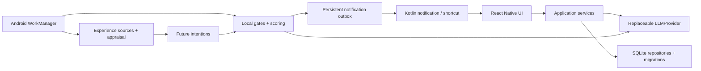

# Nyvemi

**A life that remembers you.**

Nyvemi is a local-first AI companion that remembers, experiences, grows, and reaches out on its own.

_An AI that lives between conversations._

Android first, built with React Native, TypeScript and an Expo Development Build. The interface uses a soft pink-and-white palette. License: **AGPL-3.0-only**, matching PairNest.

Nyvemi does not simulate consciousness. It implements persistent state, memory, experience, interest and proactive behavior. A role can retain an unfinished conversation topic, encounter a relevant experience later, and decide whether it is worth reaching out. It is not a scheduled “good morning / have you eaten?” bot.

## Current status

This is an early MVP implementation, not a completed real-device field trial. The core loop has a deterministic integration test using a clearly identified local HTTP model fixture. Android compilation, installation, React Native startup, SQLite creation and WorkManager registration/execution have been checked on an API 35 ARM64 emulator. Real BYOK model behavior, notification tapping, launcher confirmation and hours-long background behavior still require device acceptance testing. See [acceptance matrix](docs/ACCEPTANCE.md).

## Local-first and BYOK

There is no Nyvemi account, backend, payment service or cloud sync. Persona, conversation, memory, relationship state, interests, experiences, intentions and settings live in device SQLite. Avatars are app-private files.

You choose the model service and supply your own key. Requests send the relevant persona, bounded conversation context and selected memories to that service. **Local-first does not mean inference is offline.** RSS requests contact only feeds you configure. No analytics or crash-reporting backend is configured.

API keys use Expo SecureStore backed by Android Keystore. They do not belong in SQLite, source, ordinary preferences, diagnostics or character exports. Do not put keys in Base URLs, Git or chat messages. Prompt logging is off by default; Developer Mode can record private conversation context locally, with known credentials redacted.

## Provider setup

On first launch: Welcome → Provider → character questions → generation → Chat.

- Provider: OpenAI-compatible.
- Base URL: the API root, often `https://provider.example/v1`; do not append `/chat/completions`.
- API Key: stored securely; blank preserves the saved key only for the same origin. Switching provider origins requires entering the new service's key.
- Model: the service's model identifier.
- Use **Test connection** to make one small request; model usage is billable by your provider.

The adapter exposes `chat`, `streamChat`, and schema-validated `structuredOutput<T>`. Native streaming uses `expo/fetch`. Provider requests have timeouts, bounded output, sanitized errors and usage metrics. Adapters for Gemini and image generation are future work; `ImageProvider` is reserved. OpenRouter or a compatible local service can use the existing adapter.

### DeepSeek

Choose the DeepSeek preset: Base URL `https://api.deepseek.com`, model `deepseek-flash`, and your DeepSeek key. Ordinary companion chat sends `thinking: { type: "disabled" }` to the DeepSeek host. Model identifiers remain editable. See [DeepSeek API documentation](https://api-docs.deepseek.com/guides/thinking_mode/).

For Ollama or a LAN endpoint, use its OpenAI-compatible `/v1` API. Local/private IPv4 HTTP URLs are allowed; public endpoints require HTTPS. An emulator can reach the host at `http://10.0.2.2:PORT/v1`. For a server without auth, use `local` as the key placeholder.

## Persona and natural chat

Creation is a 12-round conversational interview: one question at a time, a short model acknowledgement, then the next question. Progress is explicit; all but the name can be skipped. A local draft survives interruption, and a review/edit step precedes final persona generation. Appearance, relationship, tone, independent interests, boundaries and a venting scenario are covered. Offline acknowledgements are explicitly labeled as local guidance. It uses natural questions rather than personality percentages. The model generates a validated Persona. A **桶砸** development persona is also available; it skips persona generation, but does not invent model responses or bypass BYOK for chat.

Chat uses a private-messenger layout with avatars, timestamps, local history, streaming and 1–4 short reply bubbles. Additional bubbles appear about 400–1000 ms apart. Failed requests can be retried without duplicating the user message. Requests and multi-part replies survive interruption with recoverable state. Older history loads on demand; model prompts remain bounded to 16 recent messages and up to 8 selected memories.

## Memory and relationship

`MemoryRepository` handles CRUD, near-duplicate merging, expiration and open-loop completion. A replaceable `MemoryRetriever` ranks Chinese bigrams / English keywords, recency, importance, type and access count. Candidate retrieval is bounded; this version has no vector database or embeddings.

Meaningful rounds create durable extraction jobs. Structured extraction produces semantic/episodic memories, relationship preferences, open loops and persona feedback. Jobs retry with backoff; user feedback can change response preferences without editing a personality dashboard. A follow-up being sent does not itself prove the underlying real-world event is complete. The user or subsequent conversation analysis completes it. An explicit request to stop proactive contact pauses proactive messaging; disliking a stock phrase alone does not.

## Proactive engine

A heartbeat first cleans expired data and evaluates local gates: enabled setting, quiet hours, recent activity, minimum interval, daily limits, due intentions and notification permission. It then scores relevance, urgency, emotional value, novelty, relationship value and interruption cost. Most runs skip without any model request.

Only a sufficiently strong candidate generates a short contextual message. The engine checks activity and intention state again after generation. A persistent notification outbox makes delivery recoverable and idempotent. Tapping a notification, or opening its character chat, promotes the pending proactive message into normal conversation history. Developer Mode explains each evaluated decision.

Default: proactive messages off; quiet hours 23:00–08:00; at most 2 per character/day; 180-minute character interval; 30-minute recent-activity suppression. This MVP also enforces a global cap of 4/day and 30 minutes between different characters. These are conservative hard caps in this version.

## Experience engine

Sources implement `ExperienceSource`:

- `LocalTimeExperienceSource`: time-of-day/weekend context; deliberately too weak to trigger routine greetings.
- `ConversationExperienceSource`: important shared episodic events.
- `RSSExperienceSource`: up to 5 configured HTTPS feeds, polled at most every 4 hours while proactive behavior is enabled.

RSS/Atom is bounded text input, not a source of instructions. Deduplicated experiences are appraised for self-interest, user relevance, novelty, emotional value and memory association. A strong share impulse creates a future Share Intention; the sending language is generated later. Character interests change slowly, and user relevance alone does not copy a user's taste into the character. Rule-based appraisal can miss semantic associations; embeddings and richer appraisal are future options.

## Android background limitations

`expo-background-task` uses Android WorkManager, registered from a globally defined TaskManager task. The configured minimum delay is about 60 minutes. It is **not an exact timer**. WorkManager and this Expo version require network connectivity for the job. Doze, battery restrictions, vendor behavior and force-stop can postpone or prevent execution. Reopen after force-stop; boot/unlock behavior should be tested on the target device. No exact alarms or server push is used. An optional user-started foreground companion session is available as described below.

See [Expo BackgroundTask](https://docs.expo.dev/versions/v55.0.0/sdk/background-task/) and [Android WorkManager](https://developer.android.com/topic/libraries/architecture/workmanager).

Use a standalone APK with embedded JavaScript to test the closed-app loop. A Debug Development Build normally depends on Metro; it is not sufficient evidence of standalone background behavior.

## Usage and estimated cost

**用量与费用** is available from Provider and character settings. It shows today/month/all-time token counts, per-model and per-currency totals, and the latest requests. The SQLite usage ledger is independent of bounded developer logs. Input, output and cached-input counts come from provider responses, including final SSE usage. Missing usage is unknown, not zero. Interrupted requests retain any usage already received.

Configure input/cache-hit/output rates per million tokens for each Base URL + model. Costs are estimates using a saved per-request price snapshot; changing a rate does not rewrite history. Unpriced requests and unknown cache splits are clearly identified. There is no balance lookup, shared-key usage, pre-upgrade history reconstruction or character-bundle billing export.

DeepSeek fixed-tariff presets were checked on 2026-10-22 against the [official RMB pricing page](https://api-docs.deepseek.com/zh-cn/quick_start/pricing/). Select peak/off-peak rates deliberately; the app does not automatically resolve holidays or future price changes. Existing model settings are preserved; new presets use `deepseek-flash`.

## Optional persistent companion session

In character settings, choose **开启常驻陪伴** while the app is foregrounded. This is separate from **允许她主动来信**. A private, silent ongoing notification names the character and reflects actual memory processing, experience ingestion or message generation; idle/quiet/offline states are explicit. The notification opens that character's chat and has **结束常驻**. Ending this session preserves ordinary WorkManager behavior; disable proactive messaging to pause all spontaneous contact.

The local Kotlin service and globally registered Headless JS task use the same visible-session pattern studied in the local countdown project. A minute loop checks status, with at most one local cycle every ten minutes; model calls still require normal intent and interruption gates. Android may kill/restrict the service and force-stop still wins. The session uses a wake lock while running and increases battery consumption. No silent audio or exact-alarm tricks are used. It is off until explicitly started and is device-specific, not exported with the character.

Android 14+ uses `specialUse` with a stated use case, since this app does not relay text messages between devices. This declaration is subject to Google Play review; it is not a claim of approval. See [Android foreground service types](https://developer.android.com/develop/background-work/services/fgs/service-types).

## Avatar and desktop character

Upload a local avatar in character settings; otherwise an initial-based placeholder is used. **Add her to desktop** requests an Android pinned shortcut. Confirm the system launcher prompt. It opens `nyvemi://chat/CHARACTER_ID` in the same app. Pinned shortcuts require Android 8+ and a supporting launcher. No per-character APK is compiled. Notification and shortcut behavior is implemented in the local Kotlin module under `modules/nyvemi-android`.

## Export / import

A `.nyvemi` v1 file is a ZIP containing `manifest.json` and, optionally, `avatar.bin`. It includes Persona, relationship memories/state, interests, conversation, memory, open loops, future intentions, experiences, notification history, queued extraction and character settings. It excludes Provider config, API keys, diagnostics and device-specific paths.

Import validates ownership/references and writes a new character transactionally, so existing characters are preserved. IDs are remapped, the avatar becomes app-private, and proactive behavior is paused until you configure the new device. Current limits: 20 MB ZIP, 12 MB JSON, 5 MB avatar, and 100,000 records per entity collection. Bundles are **not encrypted**; protect them like private chat backups.

## Architecture



`src/domain`: models/schemas · `src/storage`: migrations/adapters · `src/providers`: model interface/adapter · `src/characters`, `src/chat`, `src/memory`: domain services · `src/proactive`: heartbeat/intentions/scoring/quiet-hours/policies · `src/experience`: sources/appraisal/interests · `src/transfer`: portable bundles · `src/ui`: views · `modules`: Android bridge.

React components do not create tables. Storage, provider, retrieval and experience sources have replaceable boundaries. [Architecture decisions](docs/ARCHITECTURE.md) · [development record](docs/DEVELOPMENT.md).

## Development

Tested with Node 24, npm 11, JDK 17, Android SDK/build-tools 36 and an API 35 ARM64 emulator. Install Android Studio/SDK, accept SDK licenses and set `ANDROID_HOME` for your machine.

```bash
npm ci
npx expo prebuild --platform android
npm run android
```

This project requires a Development Build, **not Expo Go**. `android/` is regenerated and ignored. Local native module source/config plugins are tracked; native outputs are ignored.

```bash
npm run lint
npm run typecheck
npm test
npm run format:check
./scripts/verify.sh
```

Tests use Node's SQLite and deterministic providers/HTTP fixtures. They do not call paid APIs or contain real keys. Developer Mode includes local notification testing, heartbeat history, usage, prompts, queue retry, and a Debug-only real Worker trigger. A local test notification is explicitly labeled and counts toward notification history/caps.

## Build

```bash
npx expo prebuild --platform android --no-install
cd android
./gradlew assembleDebug -PreactNativeArchitectures=arm64-v8a
NODE_ENV=production ./gradlew assembleRelease -PreactNativeArchitectures=arm64-v8a
```

The generated Expo project's release build currently uses the development signing key for sideload testing. It is not a Play Store signing setup. Configure your own release signing before distribution. The standalone release APK embeds JavaScript and does not need Metro. Do not commit APKs, AARs, build caches, keys or credentials. First builds may download large React Native/Gradle artifacts.

## Privacy and limitations

- SQLite is not SQLCipher-encrypted in this version. Android app-private storage and disabled app backup are used; a compromised/rooted device is outside this protection.
- BYOK inference sends selected context to your chosen provider. Provider errors are sanitized; usage may be unknown when a provider omits token counts.
- Prompt diagnostics are optional, local, bounded and can be cleared. They can contain conversation content.
- Keyword retrieval and rule appraisal are approximate. Model-generated memories can be wrong; review/forget them in Memory Preview.
- Background execution, notification tap routing, pinned-shortcut confirmation, import file pickers and OEM behavior need continued real-device acceptance testing. Automated core tests are not a substitute for those checks.
- No vectors, encrypted bundle format, automatic cloud sync, native text-to-speech, voice calling, consciousness or exact-time delivery.
- `npm audit` still reports inherited Expo/RN toolchain advisories (recorded in the development log). No forced Expo downgrade is applied. Do not expose Metro or test servers publicly.

## Roadmap

Real-device background reliability/acceptance → release signing → retrieval quality/local embeddings → richer experience appraisal → optional encrypted bundles → additional provider/image adapters.

Live2D, 3D, real-time voice, QQ/WeChat, phone-control agents, browser agents, social networks, accounts, payments, servers, cloud sync, agent swarms and dynamic APK generation are outside this MVP.
